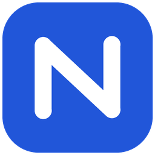

# Nexo Remote

Edición personal de acceso remoto para Windows, basada en RustDesk, con identidad azul y blanca y servidor propio configurable.

## Esta edición

- Nombre visible: **Nexo Remote**; identificador interno: `NexoRemote`.
- Interfaz de inicio clara, panel lateral blanco y tarjetas azules suaves.
- Icono propio para Windows.
- Servidor de identificación configurable al compilar; por defecto apunta únicamente al equipo local para preparar la prueba.
- Flujo manual de compilación para Windows x64, sin publicar versiones oficiales de RustDesk ni utilizar su servicio de firma.

## Estado y documentación

La primera compilación de Windows está en validación. Todavía no se ha certificado la instalación ni el acceso remoto entre redes distintas.

- [Estado técnico, compilación y servidor](NEXO-REMOTE.md)
- [Sistema de diseño](DESIGN-SYSTEM.md)
- [Documentación original de RustDesk](README-UPSTREAM.md)
- [Compilar Windows x64](https://github.com/hernansuy/nexo-remote/actions/workflows/nexo-windows.yml)

## Servidor bajo tu control

La conexión directa se utiliza cuando es posible; un servidor de retransmisión propio permite conectar equipos cuando la red impide la conexión directa. El servidor debe poder recibir conexiones desde Internet. Un PC detrás de CG-NAT no puede garantizar esa función por sí solo.

## Origen y licencia

Derivado de [RustDesk](https://github.com/rustdesk/rustdesk), GNU AGPL v3. Se conservan [la licencia](LICENCE) y los avisos originales. Primera personalización: 30 de octubre de 2026. Nexo Remote identifica esta edición personal y no una versión oficial de RustDesk.
